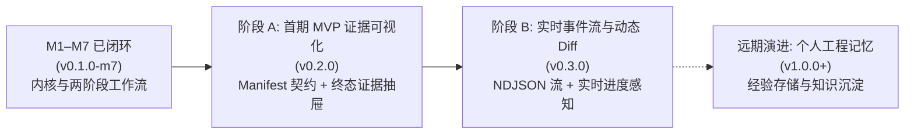
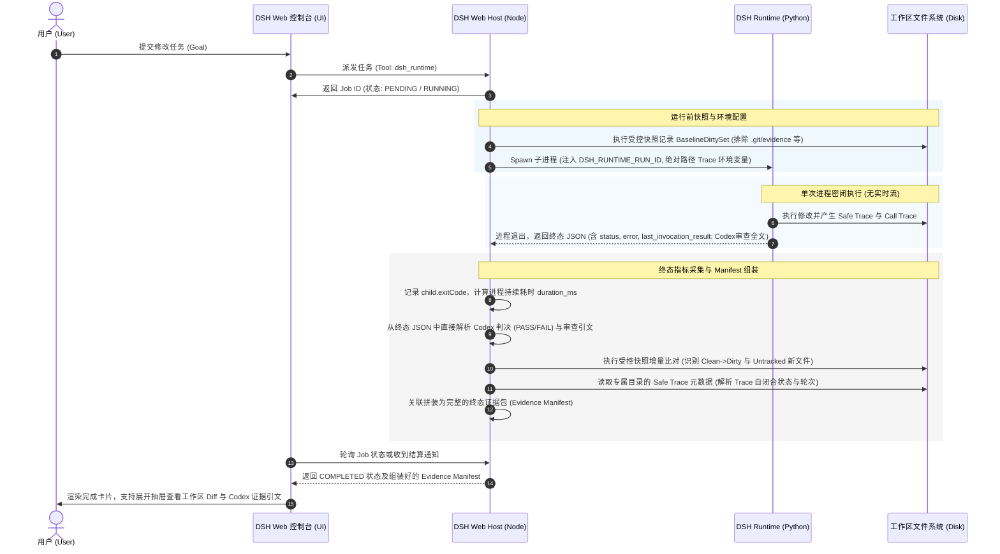
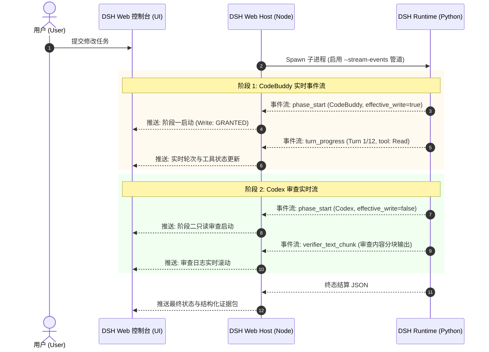

# DSH Runtime 与 DeepSeekHarness 目标形态及运行可视化设计基线 (R9)

> **文档性质**：项目负责人批准的设计基线（由 Draft Revision 9 转正）
> **文档版本**：v0.1.9-baseline
> **更新日期**：2026-10-15
> **批准记录**：2026-10-15，项目负责人确认第 8 节四项决策均选择 A。本文件是正式设计输入；原始 R9 草案保留在资料目录。
> **修订说明 (R9)**：
> 1. **流闭合证据契约与专属 `.closed` 标记规范**：澄清当前 Safe Trace 仅使用普通文件句柄而无操作系统写锁、“文件大小稳定”仅为辅助观测；明确持有句柄的写入进程特指 `dsh_runtime` Runtime 进程自身；将专属 `.closed` 标记文件定义为拟新增证据（仅在流成功关闭后创建，绑定本次 `run_id`、`trace_id`，附最终字节大小或哈希）；在无进程退出或闭合标记等充分证据时，强制降级为 `unknown` 或 `incomplete`；
> 2. **保留既有架构与批准边界**：完整保留 `worker_settled` 成功解耦、原生事件映射限定、两仓库未提交改动保留声明，以及第 8 节 4 项负责人批准记录。
> **状态标记规范**：
> - `【当前代码事实】`：经源码验证的既有逻辑、字段与行为（附文件路径与行号）；
> - `【拟新增接口契约】`：为实现可视化而设计的扩展字段、接口规范或环境变量契约；
> - `【建议】`：基于工程最佳实践提出的架构演进与交互建议方案；
> - `【待确认】`：尚需验证的技术假设或后续独立决策；第 8 节四项产品方向已批准。

---

## 1. 执行摘要

本设计基线梳理 **DSH Runtime** 与 **DeepSeekHarness** 双系统的关系、演进脉络与目标交付形态，并定义面向用户的 DSH Runtime 运行过程可视化方向。

### 核心结论摘要：
1. **产品定位演进与现实收敛**：
   - `【当前代码事实】` 2026-09-04 架构基线（[`CODEX_CONTEXT.md`](file:///D:/PythonProject/dsh-runtime/%E8%B5%84%E6%96%99%E5%BA%93/CODEX_CONTEXT.md#L11-L30)）规划的“个人工作站级 AI / 工作分身”（长效记忆、pgvector/BM25 混合检索、Obsidian 笔记集成及独立硬件部署）属于**远期愿景**；
   - `【当前代码事实】` 截至 2026-10-15（M1–M7 已闭环，[`PROJECT_STATE.md`](file:///D:/PythonProject/dsh-runtime/PROJECT_STATE.md#L35-L43) v0.1.0-m7），工程实现聚焦并交付了高可靠的“**代码仓受限治理与自动化执行引擎**”（聚焦 `repository_change` 与 `repository_inspection` 工作流，实现 CodeBuddy 写与 Codex 独立只读验的双阶段闭环）；
   - `【已批准方向】` 长期愿景保留为个人 Agent Runtime 候选演进方向，近期交付聚焦于可靠工程工作流。DeepSeekHarness 作为交互与会话宿主，DSH Runtime 作为白盒、可审计、强边界的底层可靠执行内核。
2. **证据源与 Safe Trace 边界澄清**：
   - `【当前代码事实】` CodeBuddy 的 `Safe Event Trace` 仅记录事件类型、轮次、工具名及状态等**非内容元数据**，刻意不包含文件路径、文件内容或 Diff（[`codebuddy.py`](file:///D:/PythonProject/dsh-runtime/dsh_runtime/plugins/codebuddy.py#L232-L244)）；
   - `【设计约束】` 可视化界面的变动文件清单与代码对比必须由**运行前后的工作区快照对比或实际工作区 Diff** 生成，Safe Trace 则作为操作轨迹元数据关联展示。
3. **ExecuteGate 的定位与解耦**：
   - `【当前代码事实】` D2 ExecuteGate 是 DeepSeekHarness 仓库内的**调用前资格评估门禁（Pre-call Eligibility Gate）**（[`core.ts`](file:///D:/DeepSeekHarness/deepseek-harness/scripts/d2-business-gate/core.ts#L527-L532)），评估执行资格但不代表已授权调用或调用后“无污染”背书，当前状态为 `NOT_CLAIMED`（[`r24.md`](file:///D:/DeepSeekHarness/c3-e4-codebuddy-d2/runbook/d2-project-completion-backlog-2026-10-15-r24.md#L30)）；
   - `【已批准方向】` ExecuteGate 从面向用户的产品功能路线图中剥离，归入独立的内部工程治理演进计划。
4. **运行可视化演进路径（先做什么，后做什么）**：
   - `【已批准方向】` **第一阶段（MVP）**：定义终态证据 Manifest 契约；以 DSH Web（`dsh web` 宿主）为首选方向，确认前端扩展点后，在任务完成后由宿主端整合终态 JSON（含 Codex 判决）与工作区 Diff、Safe Trace 操作轨迹，呈现“终态证据检查抽屉”；
   - `【已批准顺序】` **第二阶段（增强）**：改造子进程通信管道引入流式事件协议（NDJSON / SSE），实现 CodeBuddy 思考/工具调用的实时进度 Streaming 与动态 Diff 预览；
   - `【建议】` **第三阶段（远期）**：视独立部署需求，再评估是否提供独立桌面或独立 CLI 终端 TUI。

---

## 2. 已确认事实与来源

本节汇总从既有资料与代码实现中核实的客观事实，并按来源标明时间与性质差异。

### 2.1 资料来源与时间性质对比

| 资料名称 | 版本/时间 | 属性/定位 | 核心价值与约束 |
| :--- | :--- | :--- | :--- |
| `D:\PythonProject\dsh-runtime\资料库\CODEX_CONTEXT.md` | 2026-09-04 | 早期架构基线 | 确立了“DSH 拥有全局循环控制权”、“一切皆插件”、“白盒中控”等核心哲学，提出了包含 Memory、RAG、工作分身的长期愿景。 |
| `D:\PythonProject\dsh-runtime\PROJECT_STATE.md` | 2026-10-15 (R24评估) | 当前工程事实基线 | 记录了 M1–M7 全部闭环的工程细节、CodeBuddy+Codex 双阶段工作流、严格的参数边界（12/24 turns，100k/1M chars）及最新状态。 |
| `D:\DeepSeekHarness\c3-e4-codebuddy-d2\runbook\d2-project-completion-backlog-2026-10-15-r23.md` | 2026-10-15 | R23 运行实证 | 记录了真实代码修改（`path-alignment.spec.ts`）、`DSH_VERIFICATION: PASS` 证据链，以及终端摘要与 Safe Trace 之间的变动记录差异。 |
| `D:\DeepSeekHarness\c3-e4-codebuddy-d2\runbook\d2-project-completion-backlog-2026-10-15-r24.md` | 2026-10-15 | R24 最新审计结论 | 确认 R23 回归测试通过（5/5），无已知未解决的代码缺陷；确认 ExecuteGate `NOT_CLAIMED`，需负责人决策后续业务范围。 |
| `D:\DeepSeekHarness\deepseek-harness\packages\subagent\subagent-dsh-runtime\README.zh.md` | 当前实现 | 集成端规范 | 明确了 Harness 与 DSH Runtime 之间的单次进程协议（one-shot subprocess seam）、workspace 绑定规则及中间进度缺失等已知限制。 |

### 2.2 核心事实与技术证据链

1. **DSH Runtime 控制循环与架构闭环**：
   - `【当前代码事实】` DSH 控制器拥有全局业务循环（`DSHController.run()`），下层组件与模型无无限循环权；循环在宿主代码中而非隐藏在 Prompt 中（`CODEX_CONTEXT.md` L40-77, L658-673; `dsh_runtime/controller.py` L47-150）。
   - `【当前代码事实】` Milestone 1 至 Milestone 7 已全部正式关闭（`PROJECT_STATE.md` L61-70）：
     - M1：骨架与 Echo 闭环（`PROJECT_STATE.md` L63）；
     - M4：只读仓库分析工作流（`REPOSITORY_ANALYSIS`，Codex 负责，`PROJECT_STATE.md` L66, L159-168）；
     - M5：代码修改工作流（`REPOSITORY_CHANGE`，CodeBuddy 主执行修改，Codex 只读独立验证，`PROJECT_STATE.md` L67, L81-96）；
     - M6：真实宿主机环境验证闭环（`PROJECT_STATE.md` L68, L107-118）；
     - M7：跨语言调用边界闭环（DeepSeekHarness Node 端通过子进程接入 Python DSH Runtime，`PROJECT_STATE.md` L69, L120-129）。
2. **基线测试数字与当前状态范围**：
   - `【当前代码事实】` “全回归 117 项通过（full regression 117 passed）”是 **Milestone 7-B4 跨语言资格验收时的历史确定性基线**（`PROJECT_STATE.md` L75, L127）；
   - `【当前代码事实】` 当前最新的 R24 评估中，未重复执行全量回归套件；R24 确认的是针对 R23 所增补代码（`scripts/d2-business-gate/path-alignment.spec.ts`）的聚焦测试通过（**1 文件，5 项测试通过**，`r23.md` L11; `r24.md` L8, L13）；
   - `【当前代码事实】` R24 审计确认当前没有未解决的源码实现缺陷（`r24.md` L32）。
3. **两阶段执行与验证契约（Two-Action Workflow）**：
   - `【当前代码事实】` 对于 `REPOSITORY_CHANGE` 任务，工作流严格固定为两阶段迭代：
     - Iteration 0：调度 `CodeBuddy`，授予写权限（`allow_workspace_write=True`），执行实际代码修改（`dsh_runtime/planner.py` L24-30）；
     - Iteration 1：调度 `Codex`，强制只读（`allow_workspace_write=False`），独立审查修改并强制在末尾输出 `DSH_VERIFICATION: PASS` 或 `DSH_VERIFICATION: FAIL`（`dsh_runtime/planner.py` L31-36, L66-75）；
     - 终态决策：Planner 解析最后一行结论，完成任务或判定业务失败（`dsh_runtime/planner.py` L78-100）。
   - `【当前代码事实】` 两阶段权限存在实质差异：CodeBuddy 阶段具有写权限，而 Codex 阶段强制只读；两者由 Planner 独立 Narrowing，受 TaskState 权限上限约束（`dsh_runtime/controller.py` L61-67; `planner.py` L29, L35）。
   - `【当前代码事实】` 无自动重试/自愈死循环：M5/M7 明确冻结了契约，不引入第三次动作、不引入自愈重试循环（retry=0, repair=0, third action=0, `PROJECT_STATE.md` L89, L95, L116, L128）。
4. **工作流类型（`task_kind`）与各入口支持矩阵**：
   - `【当前代码事实】` Runtime 核心枚举、跨语言 entrypoint 与 MCP adapter 对工作流的支持范围存在明确的分层差异：

| 层次 / 入口 | 支持的 `task_kind` | 缺省行为 / 校验约束 | 代码依据 |
| :--- | :--- | :--- | :--- |
| **DSH Runtime 核心枚举** | `default`, `repository_analysis`, `repository_inspection`, `repository_change` | 核心状态机支持 4 种枚举，分别映射到 Echo、Codex 只读分析、Codex 单轮检查、CodeBuddy+Codex 双阶段修改。 | `dsh_runtime/state.py` L19-24, L43-67 |
| **跨语言子进程 Entrypoint** | `repository_change`, `repository_inspection` | **仅允许这 2 种**。若请求省略该字段则默认解析为 `repository_change`；传入其他值抛出 `ValueError`。 | `dsh_runtime/entrypoint.py` L48-74 |
| **MCP Stdio Server Adapter** | `repository_change` | **仅开放 1 种**。Input Schema 限定 enum 为 `[_TASK_KIND]`。 | `dsh_runtime/mcp_server.py` L38, L63-67 |
| **Harness Subagent Provider** | `repository_change`, `repository_inspection` | 标准预设通过 `workloadProposal: dsh-runtime` 向模型暴露提案能力；provider 校验并传给子进程。 | `README.zh.md` L96; `src/run.ts` |

5. **Safe Event Trace 与变动证据事实**：
   - `【当前代码事实】` CodeBuddy 的 `Safe Event Trace` 是非内容元数据记录（`_safe_native_event_fields`，`codebuddy.py` L232-244），仅投影捕获 `event_type`、`turn_index`、`tool_name`、`tool_status`、`progress_kind` 和 `terminal_reason`；
   - `【当前代码事实】` **Safe Trace 刻意不记录文件路径、文件内容或 Diff**；Harness 现有的 subagent provider 也明确声明：Runtime commentary、tool activity、原始 stderr 和 workspace diff 都不会进入 parent session（`README.zh.md` L75, L147）；
   - `【当前代码事实】` Safe Trace 当前仅按事件发生时间输出时间戳，**未保留能可靠配对 `tool_call` 与 `tool_result` 的调用标识（Call ID）**；
   - `【当前代码事实】` R23 实证表明，当终端文本摘要声称“未修改文件”时，真实的变动事实是由**工作区实际新增文件**与 Safe Trace 中记录的 `Write` / `Edit` 操作事件相互印证来确立的（`r23.md` L16-17）。
6. **DeepSeekHarness 宿主关系事实**：
   - `【当前代码事实】` `apps/web` 不是可用裸 Vite 独立启动的应用（`apps/web/vite.config.ts` L11-13 明确提示：`apps/web is not a standalone application: bare Vite cannot inject window.__DSH_BOOT__. From a repository checkout, run pnpm dsh web`）；
   - `【当前代码事实】` 真正的宿主是 **DSH Web 服务进程**（由 `pnpm dsh web` 启动，承载后端 API 并注入前端上下文），默认监听端口 3080。
7. **D2 ExecuteGate 证明范围与当前状态事实**：
   - `【当前代码事实】` D2 ExecuteGate 输出的核心字段是 `executionEligible: input.phase === 'ExecuteGate' && verdict === 'PASS'`，且明确记录 `gateAuthorizesInvocation: false`, `runtimeInvocationsByGate: 0`, `codeBuddyWorkersByGate: 0`（`core.ts` L527-532）；
   - `【当前代码事实】` 它属于**调用前资格评估门禁（Pre-call Eligibility Gate）**，并不执行调用，也不证明调用后的工作区状态；
   - `【当前代码事实】` 当前状态为 `NOT_CLAIMED`（`PROJECT_STATE.md` L11; `r24.md` L30）。
8. **当前 Runtime 终态 JSON 输出范围**：
   - `【当前代码事实】` 子进程终态序列化（[`entrypoint.py:101-111`](file:///D:/PythonProject/dsh-runtime/dsh_runtime/entrypoint.py#L101-L111)）输出的字段**仅有**：`task_id`, `task_kind`, `workspace_id`, `status`, `iteration`, `result`, `error`, `last_invocation_result`；
   - `【当前代码事实】` 终态 JSON 中**不包含** `exit_code`、`duration_ms`、`effective_allow_workspace_write`，亦不包含文件变动清单、Diff 或 Safe Trace 路径。
9. **标识符与路径断言事实**：
   - `【当前代码事实】` `TaskState.task_id` 在 Python 中使用 `uuid4()` 生成纯 UUID 字符串（`state.py` L32）；
   - `【当前代码事实】` `call_trace.py:14-16, 89-91` 明确断言 `_CALL_ID_PATTERN` 必须是标准 36 字符十六进制 UUID（任何带 `call-` 等非 UUID 前缀的字符串都会被正则拒绝），且断言环境变量 `DSH_RUNTIME_CALL_TRACE_PATH` **必须是绝对路径**（否则抛出 `CallTraceError`）。
10. **本地源码仓库既有状态事实（`【当前客观事实】`）**：
   - `【当前客观事实】` 经现场环境检查，当前两个源码仓库（`D:\PythonProject\dsh-runtime` 与 `D:\DeepSeekHarness\deepseek-harness`）均存在未提交的修改或未跟踪文件；
   - `【当前客观事实】` 鉴于在本次多轮方案审阅启动前未建立专门的前置状态快照，**客观上无法根据当前状态断言这些未提交改动是在何轮次产生、与本轮讨论是否相关，亦不能认定由本轮造成**；
   - `【约束】` 在本设计的实施过程中，**严格保留现有工作区改动与未跟踪文件，严禁执行任何重置（`git restore`）、清理或覆盖操作**。

---

## 3. 候选最终形态

### 3.1 一句话产品定义
`【建议】`
**DSH (DeepSeekHarness x DSH Runtime) 是一个面向专业开发者的“本地优先、白盒可审计、具备双模型交叉验证能力”的个人智能软件工程工作站。**

### 3.2 目标用户与主要使用场景
- **目标用户**：`【建议】`
  - 对代码质量、修改确定性、数据隐私有严苛要求的软件工程师与架构师；
  - 关注 AI 改动过程透明度、需要防止模型越权执行与自发死循环的技术团队。
- **核心场景**：`【建议】`
  1. **受控的工程修改与重构（`repository_change`）**：在本地工作区内由 CodeBuddy 生成修改，并由独立的 Codex 严格审查且给出 PASS/FAIL 判决，改动全程留痕；
  2. **深度代码仓探查与架构审查（`repository_inspection`）**：在严格只读权限下对代码库进行依赖梳理、模式分析与安全排查，输出结构化报告；
  3. **高安全性自动化工作流接入**：作为开发团队 CI/CD 或本地开发环境的受控后端，通过严格的参数限制（Token/Turn/Bash白名单）执行确定性维护任务。

### 3.3 系统职责切分与边界定义

```
┌────────────────────────────────────────────────────────────────────────┐
│                      DeepSeekHarness (交互与控制平面)                    │
│  - 用户界面 (Web UI / Desktop)          - 会话与多轮上下文管理          │
│  - 模型网关与路由 (Cloud LLM / API)      - Subagent 治理与调度           │
│  - 用户权限确认交互 (Approval Modal)     - 运行状态呈现与通知            │
└───────────────────────────────────┬────────────────────────────────────┘
                                    │ Subprocess Seam (JSON Stdio / MCP)
                                    ▼
┌────────────────────────────────────────────────────────────────────────┐
│                        DSH Runtime (执行与验证内核)                     │
│  - 白盒任务循环控制 (DSHController)      - 任务状态机 (TaskState)        │
│  - 严格权限上限 (allow_workspace_write)  - 超时与资源熔断 (Budget/Turn)   │
│  - 两阶段编排 (Planner: CodeBuddy->Codex)- 本地证据链记录 (Call/Safe Trace)│
└───────────────────┬────────────────────────────────┬───────────────────┘
                    ▼                                ▼
       ┌────────────────────────┐       ┌────────────────────────┐
       │   CodeBuddy (主执行器)  │       │   Codex (独立验证器)   │
       │ - 负责具体的代码检索与修改 │       │ - 强制只读检查与比对   │
       │ - 权限: Read/Edit/Write│       │ - 给出终态 PASS/FAIL   │
       │ - 受控 Bash(python:*)  │       │ - 提取证据与行号依据   │
       └────────────────────────┘       └────────────────────────┘
```

#### 职责矩阵：
- **DeepSeekHarness 负责**：`【当前代码事实】` 用户图形界面、多轮人机交互、会话持久化、通用 Agent Preset、模型网关路由、派发前置治理审查。
- **DeepSeekHarness 不负责**：`【当前代码事实】` 底层两阶段任务迭代循环控制、代码修改的具体读写执行、验证裁决逻辑、低层子进程权限拦截。
- **DSH Runtime 负责**：`【当前代码事实】` 单次任务生命周期（`TaskState`）、两阶段任务编排、有效权限计算（`allow_workspace_write`）、执行预算与超时熔断、执行证据链固化（Call Trace & Safe Trace）。
- **DSH Runtime 不负责**：`【当前代码事实】` 复杂前端渲染、用户多轮聊天上下文聚合、跨网络远程多租户调度、云端凭证托管。
- **模型/执行插件（CodeBuddy / Codex）负责**：`【当前代码事实】` 在分配的具体阶段内执行动作。CodeBuddy 专职实现改动；Codex 专职只读审计并给出终态裁判。
- **模型/执行插件不负责**：`【当前代码事实】` 决定任务是否完结、决定是否自发重试、篡改全局状态。

### 3.4 核心能力清单与实现状态矩阵

| 能力项 | 归属模块 | 状态 | 状态说明与证据引用 |
| :--- | :--- | :--- | :--- |
| **两阶段改动闭环（修改->验证）** | DSH Runtime | `【已实现/已验证】` | M5/M6/M7 闭环，CodeBuddy 写 + Codex 验证已通过宿主环境检验（`PROJECT_STATE.md` L81-96, L120-128）。 |
| **只读仓库探查（Inspection）** | 双端支持 | `【已实现/已验证】` | 核心与 entrypoint 均支持 `repository_inspection`（`entrypoint.py` L49; `state.py` L22）。 |
| **只读仓库分析（Analysis）** | Runtime 核心 | `【已实现/已验证】` | 核心支持 `repository_analysis`（`state.py` L21），但 entrypoint 未直接开放该枚举。 |
| **子进程跨语言标准对接** | 双端桥接 | `【已实现/已验证】` | M7 闭环，支持 Node 端通过 subprocess seam 启动 Python runtime（`PROJECT_STATE.md` L120-129）。 |
| **严格资源与命令熔断** | DSH Runtime | `【已实现/已验证】` | CodeBuddy 轮数（12/24）、字符截断（100k/1M）、`Bash(python:*)` 白名单已固化（`codebuddy.py` L33-46）。 |
| **轻量级隐私脱敏调用追踪** | DSH Runtime | `【已实现/已验证】` | `calls.jsonl` 仅存哈希与状态，不存 Prompt 与代码（`call_trace.py` L47-64）。 |
| **操作行为元数据安全追踪** | DSH Runtime | `【已实现/已验证】` | `Safe Event Trace` 捕获事件类型与工具元数据，不存文件路径与内容（`codebuddy.py` L232-244）。 |
| **终态证据 Manifest 契约** | 双端桥接 | `【拟新增接口契约】` | 首期 MVP 需显式定义，用于向宿主交付 Diff、元数据与判决引文（本方案建议）。 |
| **执行过程实时进度流（Streaming）** | 双端通信 | `【待开发】` | 当前仅返回终态 JSON，无运行时中间事件推送（`subagent-dsh-runtime` `README.zh.md` L168）。 |
| **面向用户的运行可视化 UI** | DeepSeekHarness | `【待开发】` | 本设计基线定义的交互视图，目前尚未实现。 |
| **长效工作记忆（Memory Layer）** | DSH Runtime | `【长期愿景/延期】` | `CODEX_CONTEXT.md` 设想，M1–M7 未排期，保留为候选演进方向。 |
| **RAG 混合检索（pgvector/BM25）** | DSH Runtime | `【长期愿景/延期】` | `CODEX_CONTEXT.md` 设想，当前依靠模型直接检索文件，未引入外部向量库。 |

---

## 4. 当前交付与目标差距

```
[当前状态: v0.1.0-m7 (稳定执行内核)]
  │
  ├─ 差距 1: 信息黑盒 ───► 调用期间用户面对白屏或转圈，无法感知执行进展
  ├─ 差距 2: 结果摘要漂移 ─► R23 中出现终端文字声称无修改，但实际磁盘与 Trace 已修改的冲突
  ├─ 差距 3: 证据链未串联 ─► 变动文件 Diff、Safe Trace 操作元数据、Codex 审查结论分散，缺乏统一视图
  ├─ 差距 4: 终态证据接口缺失 ─► 当前 entrypoint 终态 JSON 仅有 8 个基础字段，无结构化证据清单与运行指标
  │
  ▼
[目标状态: 可视化可观测的个人工程工作站]
```

### 差距分析明细：
1. **运行感知差距**：
   - 当前事实：调用发起后，Node 子进程同步等待 Python 进程退出（`README.zh.md` L168），执行耗时可达 200–300 秒，期间前端无任何事件推送。
   - 目标要求：首期实现清晰的等待状态与终态完整证据展示；中期实现阶段切换与实时轮次感知。
2. **状态归因与摘要呈现差距**：
   - 当前事实：R23 报告记录了“终端文本摘要与实际变动不一致”的问题（R23 L16-17）。
   - 目标要求：UI 不能盲信模型生成的口语化回复，界面的“变动文件清单与内容对比”必须直接基于**工作区实际 Diff** 生成，并与 Safe Trace 操作轨迹相互印证。
3. **终态证据与指标归属差距**：
   - 当前事实：`entrypoint.py:101-111` 的 `_serialize_task` 仅输出 8 个基础字段，**不包含**退出码、持续耗时、有效权限分阶段状态与证据文件索引。
   - 目标要求：必须制定首期 MVP 证据传递契约（Evidence Manifest），清晰划分宿主采集（退出码、耗时、Diff、Safe Trace 聚合）与 Runtime 输出（TaskState、Codex 审查结论）的归属。

---

## 5. 分阶段产品路线图与独立工程治理计划

### 5.1 面向用户的产品功能路线图（建议）



| 阶段 | 里程碑目标 | 前置依赖 | 核心交付物 | 可验证的验收标准 |
| :--- | :--- | :--- | :--- | :--- |
| **当前状态** | **M1–M7 闭环** | 已完成 | 稳定的 Python DSH Runtime 内核、MCP Adapter、Harness Provider | 历史 117 项全回归通过，R24 路径对齐 5/5 测试通过，宿主两阶段运行闭环。 |
| **阶段 A (首期 MVP)** | **终态运行可视化与证据审查面板** | 当前 M7 产物 | 1. 制定终态证据 Manifest 契约；<br/>2. 工作区 Diff 生成与 Safe Trace 元数据关联解析模块；<br/>3. DSH Web 增加 `Runtime Inspector Drawer` 组件。 | 1. 任务完成后，用户能一键展开抽屉查看由工作区 Diff 生成的变动文件清单；<br/>2. 抽屉内关联展示 Safe Trace 操作轮次；<br/>3. 正确展示 Codex 终态判决（PASS/FAIL）及引用的证据行。 |
| **阶段 B (中期增强)** | **实时进度事件流与动态 Diff** | 阶段 A 完成 | 1. Python `entrypoint` 增加流式事件管道；<br/>2. Harness provider 接入流式解析并广播；<br/>3. 前端集成 Monaco/Diff 动态查看器。 | 1. 执行中实时更新当前轮数（Turn x/12）与动作状态；<br/>2. Codex 审查阶段逐步输出审查日志；<br/>3. 提供直观的代码行增删高亮。 |
| **远期演进 (v1.0+)** | **个人知识与工程经验沉淀** | 长期稳定运行 | 1. 结构化项目经验提取；<br/>2. 语义工作区映射管理。 | 1. 跨机器迁移时不丢失工程经验；<br/>2. 任务调度能参考历史决策。 |

---

### 5.2 独立的内部工程治理计划（非用户产品功能）

`【已批准方向】` 将 D2 ExecuteGate 明确剥离出产品功能路线图，纳入内部工程与治理安全演化专项：

```
[内部工程治理专项: D2-Business-Gate]
  ├─ 现状: 门禁代码已具备资格评估逻辑 (core.ts)，当前状态为 NOT_CLAIMED (r24.md:30)
  ├─ 定位: 调用前资格评估门禁 (Pre-call Eligibility Gate)，防漂移、防误执行安全锁
  └─ 后续演化路径 (需负责人独立决策):
       1. 维持 NOT_CLAIMED 现状，保持现有合规锁定，不阻塞可视化产品研发；
       2. 若未来有发布验收需要，由负责人明确具体业务范围、生成版本化请求与预授权快照，再行正式申领。
```

---

## 6. 运行可视化方案（初步设计）

### 6.1 设计原则与权衡考量
1. **真实变动与元数据分离（Ground Truth from Diff, Trajectory from Trace）**：
   - 变动文件列表与 Diff 内容**必须且只能**来源于运行前后的实际工作区文件快照比对（或 Git Diff）；
   - Safe Event Trace 用于提供操作行为轨迹（工具调用成功/失败、轮次、耗时），两者在前端联合呈现。
2. **模型陈述与系统证据分离（Separation of Commentary and Evidence）**：
   - 模型自然语言总结仅作为参考文本呈现；若模型声称“未修改”但工作区实际产生 Diff（如 R23 现象），界面应以系统检测到的实际 Diff 为准，并给出提示标记。
3. **隐私安全要求（待满足的设计目标）**：
   - 界面所有日志与 Diff 直接在本地读取渲染，不向第三方分析服务上报；
   - 敏感信息（如 API Key、Token）在界面渲染时强制进行掩码脱敏（`sk-***`）；
   - `【说明】` 本地 UI 保证的是**前端呈现与本地数据存储的私密性**，不能推导出整体“完全离线/本地化”，因为模型推理仍会向云端提供商传输 Prompt 与代码。

---

### 6.2 方案形态对比与宿主集成路径分析

| 方案形态 | 架构实现路径 | 优势 | 劣势与前置条件 | 推荐结论 |
| :--- | :--- | :--- | :--- | :--- |
| **方向 1：集成至 DSH Web** | 在 `dsh web` 宿主（Node Host + 前端 bundle）中增加 Inspector 组件与证据读取端点。 | 贴合现有交互习惯；复用现有 Job 机制与端口 3080。 | 需明确 Node Host 上的证据文件读取 API 与前端挂载点。 | `【已批准首选】` |
| **候选方向 2：独立 Desktop 窗口** | 基于 `apps/desktop` 构建独立工程窗口。 | 原生桌面体验，支持系统托盘。 | 桌面端打包与维护成本高。 | `【建议后续评估】` |
| **候选方向 3：DSH Runtime 独立控制台** | Python 内置轻量 HTTP 服务与独立 UI。 | 脱离 Harness 独立可用。 | 与 Harness Web 存在重复建设风险。 | `【建议暂缓】` |

---

### 6.3 页面视图与信息架构设计（基于 DSH Web 候选方案）

> **图示说明**：以下卡片与抽屉展示内容包含**基于 R23 历史执行案例的合成示意数据（Synthetic Mock Data）**，仅用于阐述界面视觉层级与信息组织关系，非当前实时运行证据。

#### 视图 1：任务面板卡片（Task Summary Card - 示例）
嵌入在会话流中，展示单次 `dsh_runtime` 调用的摘要。
- **头部**：任务目标（Goal）、工作流类型（`repository_change` / `repository_inspection`）、状态徽章（`RUNNING` / `COMPLETED` / `FAILED` / `TIMED_OUT`）；
- **主体运行指标（示意数据 / 实际运行时读取生效配置与实测值）**：
  - 迭代状态：`Iteration: 2 / 2` *(示意)*
  - 耗时统计：`Elapsed: 224.2s` *(示意)*
  - 权限边界：`Workspace Write: GRANTED (Phase 1 CodeBuddy Only)`（写权限阶段激活徽章）
  - 资源消耗：`CodeBuddy Turns: 5 / 12 (Config Max: 12)` | `Output Chars: 38,420 (Config Max: 1,000,000)` *(示意数值，界面读取实际统计)*
- **底部操作**：`[查看执行证据抽屉]`、`[查看变动 Diff]`。

#### 视图 2：运行详情与证据抽屉（Runtime Inspector Drawer - 历史案例示意）
点击卡片后从右侧滑出，提供三标签页深度审查：

```
┌────────────────────────────────────────────────────────────────────────┐
│  DSH Runtime Inspector  -  Task: 6b8f1a23-4c5d-4e6f-8a9b-0c1d2e3f4a5b  │
├────────────────────────────────────────────────────────────────────────┤
│  [ 执行轨迹 (Trajectory) ]    [ 工作区变动 (Diff) ]    [ 审计凭据 (Audit) ] │
├────────────────────────────────────────────────────────────────────────┤
│                                                                        │
│  ● 准入检查: Workload: repository_change                     [ ALLOW ] │
│                                                                        │
│  ● 阶段一: CodeBuddy 主执行器                                [ 完成 ]  │
│    ├─ 权限授权: phase_1_effective_write = true (阶段允许修改)         │
│    ├─ 状态: 正常退出 (耗时 45.5s) [示意]                               │
│    ├─ 轮次消耗: 5 turns (生效配置上限: 12 turns) [示意]                 │
│    └─ Safe Trace 操作轨迹元数据 (非内容，工具调用状态序列):            │
│       ├─ Turn 1: tool_call (Read) -> completed                        │
│       ├─ Turn 2: tool_call (Read) -> completed                        │
│       ├─ Turn 3: tool_call (Edit) -> completed                        │
│       └─ Turn 4: tool_call (Write) -> completed                       │
│       (注: 单次工具耗时属于【待新增能力】，需引入安全配对标识)         │
│                                                                        │
│  ● 阶段二: Codex 独立只读验证器                              [ 完成 ]  │
│    ├─ 权限授权: phase_2_effective_write = false (强制只读审计)        │
│    ├─ 审查耗时: 149.1s [示意 / 拟新增阶段计时契约]                      │
│    ├─ 审查判决: [ DSH_VERIFICATION: PASS ]                             │
│    └─ 审查证据引文 (来自 Runtime 终态 JSON last_invocation_result):     │
│       "[历史示意] Inspected spec: assertions match required literals." │
│                                                                        │
│  ● 终态结算 (Terminal Settlement)                            [ 成功 ]  │
│    └─ Exit Code: 0 (Harness 采集) | Total Duration: 224.2s [示意]      │
│                                                                        │
├────────────────────────────────────────────────────────────────────────┤
│  工作区实际变动 (来自快照对比，physical_isolation: none_shared_workspace)│
│  [历史示意] + scripts/d2-business-gate/path-alignment.spec.ts (+85L)   │
│  Call Trace 签名: ec2742c58f89... (call_id: 9f8e7d6c-5b4a-4f2e-bd0c...)│
└────────────────────────────────────────────────────────────────────────┘
```

---

### 6.4 交互时序设计（分阶段）

#### 第一阶段（首期 MVP）：基于 Job 轮询与终态证据包的交互流程



---

#### 第二阶段（中期增强）：基于实时流式管道（NDJSON / SSE）的交互流程（建议）



---

### 6.5 首期终态证据接口契约与关联落地规则（Evidence Manifest Specification）

#### 1. 数据来源与指标归属矩阵（当前代码事实 vs 拟新增接口契约）

针对当前 Runtime 终态 JSON 仅有 8 个基础字段的现状，下表清晰界定各项证据与运行指标的真实来源及采集契约：

| 指标 / 字段 | 当前代码事实归属 | 拟新增采集 / 呈现契约 | 语义与约束说明 |
| :--- | :--- | :--- | :--- |
| `task_id`, `status`, `task_kind` | Runtime 终态 JSON（`stdout`） | 直接透传入 Manifest | 核心任务标识与状态枚举（[`entrypoint.py:101`](file:///D:/PythonProject/dsh-runtime/dsh_runtime/entrypoint.py#L101)），`task_id` 为标准 UUID |
| `exit_code` | **当前不在终态 JSON 中** | 由 Harness 监听子进程退出事件（`child.exitCode`）采集 | 整数退出码（0 表示正常退出） |
| `duration_ms` | **当前不在终态 JSON 中** | 由 Harness 从 Spawn 到 Exit 计时采集，或从 CallTrace 提取 | 毫秒级任务总耗时 |
| `effective_authority` (有效权限) | **当前不在终态 JSON 中**；`controller.py` 按阶段独立计算 | **显式区分两阶段权限**：<br/>- Task Ceiling: `allow_workspace_write`<br/>- Phase 1 (CodeBuddy): `true`<br/>- Phase 2 (Codex): `false` | 杜绝用单一布尔值掩盖阶段差异：CodeBuddy 允许修改，Codex 强制只读 |
| `verification` (判决与引文) | Runtime 终态 JSON 的 `last_invocation_result` 字段 | Controller 捕获 Codex 输出，Harness 从终态 JSON 解析 | 解析末行是否为 `DSH_VERIFICATION: PASS/FAIL`，前文为引文 |
| `verification.stage_duration_ms` | **当前不在终态 JSON 中** | **【拟新增阶段计时契约】** | 由 Runtime 阶段打点或 Harness 流式计时采集，未实现前不应伪造 |
| `workspace_changes` (Diff 及清单) | **不属于 Runtime 职责** | 由 Harness 证据端在运行前后独立执行受控快照比对生成 | 涵盖受管已跟踪文件与非忽略的未跟踪新文件（排除运行前脏改动） |
| `execution_trajectory` (操作元数据) | 本地 Safe Event Trace 文件（JSONL） | 由 Harness 凭专属绝对路径读取并聚合元数据 | 包含 Trace 自闭合状态与轮次，单次耗时属于待新增能力 |
| `audit` (CallTrace 审计哈希) | 本地 `calls.jsonl` 文件 | 由 Harness 读取专属 Trace 文件中记录的 `call_id` 与哈希 | 脱敏审计指标，`call_id` 必须为合规 UUID |

---

#### 2. 独立运行 ID 命名空间与绝对路径 Trace 关联契约

- **独立命名空间规范（`【拟新增接口契约】`）**：
  - **严禁使用** `d2-business-<uuid>` 或 `DSH_D2_DISPATCH_RUN_ID`，避免与正式 D2 Gate 身份混淆；
  - 可视化运行统一采用独立命名空间：`dsh-runtime-<uuid>`（例如 `dsh-runtime-7a8b9c0d-1e2f-4a3b-8c5d-6e7f8a9b0c1d`）；
  - 环境变量注入规范：`DSH_RUNTIME_RUN_ID = "dsh-runtime-<uuid>"`。
- **绝对路径强制约束（`【当前代码事实】` 与契约）**：
  - `call_trace.py:89-91` 明确断言 `DSH_RUNTIME_CALL_TRACE_PATH` 必须是**绝对路径**（否则抛出 `CallTraceError`）；
  - 因此，所有证据目录（`evidence_dir`）、CallTrace 路径与 Safe Trace 路径在跨语言传递时**必须使用绝对路径**（如 `D:/DeepSeekHarness/c3-e4-codebuddy-d2/evidence/...`），杜绝因子进程 `cwd` 差异引发路径偏移。
- **CallTrace 关联与合法 UUID 规则（`【当前代码事实】` 与契约）**：
  - *代码事实*：`call_trace.py:14-16` 正则严格断言 `call_id` 必须是合规标准 36 字符 UUID；`call_trace.py` 内部**没有** `run_id` 字段；
  - *关联契约*：首期通过**每次运行专属的绝对路径**（`DSH_RUNTIME_CALL_TRACE_PATH = "<abs_evidence_dir>/<runtime_run_id>-runtime-call-trace.jsonl"`）实现物理隔离关联；
  - 任务结束后，Harness 打开该独立文件，读取真实的 `call_id` 并记入 Manifest；在数据结构中，`task_id`、`call_id` 与 `run_id` 保持完全独立。
- **Safe Trace 专属绝对目录注入契约**：
  - Harness 注入：`DSH_CODEBUDDY_SAFE_EVENT_TRACE_DIR = "<abs_evidence_dir>/safe-trace-<runtime_run_id>"`；
  - 任务结束后，Harness 打开该专属目录聚合操作轨迹。

---

#### 3. Safe Trace 状态解耦、观测范围界定与轮次指标契约

为精准呈现操作轨迹并在异常时提供稳健的降级体验，定义如下状态机与指标解析契约：

```
[Safe Trace 状态机 (仅描述 Trace 自身闭合状态，与 Runtime 任务最终成功/失败解耦)]
  │
  ├─ 任务为 repository_inspection 等只读工作流 ──► not_applicable (不适用/未启用)
  │
  ├─ 任务为 repository_change，但启动前报错/未生成 ──► unavailable (未产生/不可用)
  │
  ├─ Worker 进程异常中断，缺失正常闭合/事件流截断 ──► incomplete (不完整/未闭环)
  │
  └─ Worker 原生事件流闭合且包装安全收尾 ────────► available (正常可用)
```

- **状态解耦与原生事件 vs 包装收尾判定原则（Decoupled Trace State & Termination Distinction）**：
  - `【事件分层与解析器映射事实】` Safe Trace 中记录了两类终止态事件：
    - **底层原生事件映射（`【待验证协议版本】`）**：`worker_phase="worker_output"` 阶段的 `progress_kind="native_terminal_observed"`（[`codebuddy.py:273-275, 478-482`](file:///D:/PythonProject/dsh-runtime/dsh_runtime/plugins/codebuddy.py#L273-L275)），**仅限定为当前包装层解析器（`_safe_native_event_fields`）对子进程 stdout 原生 `{type: "result"}` 事件所观察到的映射行为**；其 CLI 身份通过 `_safe_stream_cli_identity`（[`codebuddy.py:647-702`](file:///D:/PythonProject/dsh-runtime/dsh_runtime/plugins/codebuddy.py#L647-L702)）尝试解析 `@tencent-ai/codebuddy-code` 的 `package.json` 并记录于 Trace 头部的 `cli_identity` 中；由于上游协议规范与版本语义未在当前仓内公开，该映射在跨版本间的稳定性标为 `【待验证】`；
    - **外层包装收尾**：`worker_phase="settled"` 阶段的 `progress_kind="worker_settled"`（[`codebuddy.py:492-498`](file:///D:/PythonProject/dsh-runtime/dsh_runtime/plugins/codebuddy.py#L492-L498)），源自 Python 插件在子进程退出后的 `finish()` 清理逻辑。
  - **`worker_settled` 与任务成功解耦（`【当前代码事实】`）**：
    - `worker_settled` **仅代表 Python 插件包装层完成了收尾（`finish()`）清理逻辑，绝不代表底层 Worker 任务执行成功**；
    - **成功判定归属**：底层 Worker 任务的业务成功必须结合 `terminal_reason` 判定（`terminal_reason == "completed"` 为正常完成，而 `max_turns_exceeded` / `worker_failure` / `quota_exceeded` 为非成功终止）；整体任务的最终业务成败则由 Phase 2 Codex 审查结论（`DSH_VERIFICATION: PASS/FAIL`）最终裁定。
  - **`available` 判定与文件流干净闭合的可观测证据契约（`【拟新增契约 / 待验证事实】`）**：
    - **严禁将外层包装收尾当作原生流结束**：绝不能单纯因为在文件末尾读到了 `worker_settled` 就判定 Trace 正常闭环；
    - `【代码事实揭示】` 当前实现（`codebuddy.py:490-520`）是**先向文件写入终态记录（`worker_settled`），随后才调用 `self._stream.close()`**；若流关闭操作抛出异常，代码仅在内存中更新 `self.incomplete = True`，该异常并未持久化写入 Trace 文件；
    - `【句柄与锁机制澄清】` `codebuddy.py` 在落盘 Safe Trace 时使用的是标准 Python 普通文件句柄（`open(...)`），未在操作系统层面显式取得排他写锁；持有该写句柄的写入进程特指 **`dsh_runtime` Runtime 进程自身**（而非外部独立工作进程）；因此，“文件大小稳定”仅能作为辅助观测，不能作为确定性的闭合判定；
    - `【可观测证据判定契约】` 将“文件流干净闭合”定性为 `【拟新增契约 / 待验证事实】`。Manifest 证据收集端在判定流闭合与 `available` 时，**必须基于以下外部可验证物理证据**：
      1. **原生终止事件到达**：观测流中捕获到了原生终止记录（`progress_kind: "native_terminal_observed"`）；
      2. **包装收尾未标记异常**：外层包装收尾记录的 `progress_kind` 确为 `"worker_settled"`（而非 `"trace_incomplete"` 或 `"trace_quota_exceeded"`）；
      3. **JSONL 尾行结构完整性**：读取 Trace 文件末尾字节，验证最后一行必须以完整的换行符（`\n`）结束，且能被 `JSON.parse` 完整反序列化，绝无半截字符或破损字节；
      4. **持有句柄的 Runtime 进程已退出**：Harness 确认持有 Trace 文件写句柄的 `dsh_runtime` 子进程已完全退出（`child.exitCode !== null`），确保写入上下文彻底终止；“文件大小稳定”仅作为辅助观测；
      5. **【拟新增专属闭合标记证据（`.closed` Marker）】**：
         - 在 `dsh_runtime` 中定义专属闭合标记文件（例如 `<trace_file>.closed`）；
         - **创建时机**：**必须且仅在 `self._stream.close()` 成功返回后由 Runtime 创建**，杜绝异常中断时误建；
         - **绑定元数据**：文件内容以 JSON 记录，严格绑定当次 `run_id` 与 `trace_id`；
         - **校验载荷**：附带 Trace 文件的最终字节大小（`final_bytes`）或 SHA-256 哈希值（`trace_sha256`），供 Harness 比对文件完整性。
    - **证据不足降级规则**：若缺乏持有句柄的 `dsh_runtime` 进程正常退出凭据，或缺乏有效的专属 `.closed` 闭合标记等充分证据时（例如仅见未落盘闭合标记、尾部残缺字节或进程挂死），Manifest **必须将流闭合状态与 Trace 状态降级为 `unknown`（未知）或 `incomplete`（未闭环）**，严禁误判为 `available`。
  - **业务解耦性**：在满足上述证据闭环的前提下，Trace 即为 `available`，**明确不以 Runtime 任务整体成功为条件**。典型场景：CodeBuddy 执行完毕且事件流正常结算，Safe Trace 为 `available`；即便后续 Codex 审查阶段因发现缺陷返回 `DSH_VERIFICATION: FAIL` 导致任务整体以 `failed` 终态退出，**Safe Trace 的状态依然保持 `available` 和 `trace_complete: true`**。
- **Manifest 字段规范（`【拟新增接口契约】`）**：
  - `status`: `"not_applicable"` | `"unavailable"` | `"unknown"` | `"incomplete"` | `"available"`；
  - `trace_complete`: 布尔值。**严格限定其语义为“观测流范围内完整（observed stream complete）”**（仅代表在当前 Observer 收集窗口内捕获了闭合的 Worker 事件流，不代表跨进程物理全生命周期完成）。
- **轮次指标来源、基数假设与统计限制（Turns Metrics Contract）**：
  - `turns_used`（实际消耗轮次）：
    - *基数现状与待验证假设*：`【当前代码事实】` `codebuddy.py:280-286` 仅简单校验并透传非负整数（`type(raw_turn_index) is int and raw_turn_index >= 0`），代码中未包含 CodeBuddy CLI（`@tencent-ai/codebuddy-code`）的外部公开协议文档或版本契约；**因此，将原生 `turn_index` 认定为 0-based 属于 `【待验证假设】`**，需在后续与 CodeBuddy 团队对齐协议规范；
    - *严格统计限制*：
      - 仅在索引经验证为**从 0 开始、严格连续且每轮均有记录**时，才允许通过 `max(turn_index) + 1` 计算实际轮次；
      - 若索引存在断档、不连续或仅部分事件携带索引，无法断定完整轮数，`turns_used` 必须为 `null`；可另以 `turns_metrics_status: "partial"` 和 `max_observed_turn_index` 呈现部分记录，不将显示文案混入数值字段；
    - *缺失规则与边界澄清*：若 Safe Trace 状态为 `not_applicable`，该字段记为 `null`（UI 呈现为“不适用”）；若索引来源为 `turn_index_source == "unavailable"`（即原生事件未提供轮次标号），该字段返回 `null`（UI 呈现为“未记录”）。**【重要契约】绝不能因为索引来源为 `unavailable` 就误判 Trace 发生截断**（Trace 截断仅由事件流是否缺失闭合终止事件决定，与事件内是否携带轮次数字完全正交）；
    - *截断呈现*：仅当 Safe Trace 自身状态为 `incomplete`（由于子进程异常中断导致事件流截断）时，呈现当前已捕获的最大轮次并附加“（流截断）”警示；
  - `max_turns_config`（配置上限）：
    - *数据来源*：由 Harness 从当次启动子进程时注入的环境变量 `DSH_CODEBUDDY_MAX_TURNS` 读取；
    - *缺失规则*：若未设置环境变量或解析异常，采用默认值 12（`codebuddy.py:36`）并标记来源为 `default`。
- **工具耗时能力定位（`【待新增能力】`）**：
  - `【当前代码事实】` 当前 Safe Trace 仅记录工具名、状态与时间戳，**未包含能可靠配对 `tool_call` 与 `tool_result` 的调用标识**；在异步或交错事件流下，单纯按相邻时间戳计算单次工具耗时不可靠；
  - `【契约设计】` **单次工具耗时列为待新增能力**；若后续版本需支持单次工具耗时展示，必须首先在 Safe Trace 中定义**隐私安全的事件配对字段**（例如对内部 callId 执行单向哈希 `opaque_tool_call_hash`，或局部自增序号 `tool_call_seq`），在绝不泄露代码与参数内容的前提下实现精确配对计时。

---

#### 4. 工作区受控快照、中性命名与程序化 Diff 边界规范

变动文件清单与 Diff 必须真实反映执行窗口内观察到的工作区净变化，并遵守以下四项工程准则：

1. **受控快照范围与排除规则（Controlled Snapshot Scope & Exclusions）**：
   - **覆盖范围**：目标工作区内**所有已跟踪文件（无论运行前为 Clean 还是 Dirty 状态）以及非忽略的未跟踪文件（Non-ignored Untracked Files）**，确保发现运行前干净文件发生的新改动，避免遗漏新建代码；
   - **版本化排除策略（`exclusion_policy_id: "dsh_controlled_snapshot_v1"`）**：快照扫描基于 Git 索引与工作区受管目录的受控遍历，**显式且完整地排除**以下非代码范围，杜绝无节制递归扫描与模糊匹配：
     - 版本控制系统目录：`.git/`；
     - 依赖与构建产物：`node_modules/`, `dist/`, `build/`, `__pycache__/`；
     - 虚拟环境与工具链：`.venv/`, `.node-v24/`；
     - 临时文件与日志：`.tmp/`, `*.log`, `*.tmp`；
     - **Runtime 自身专属证据目录**：`evidence/dsh-runtime/<run_id>/`（或通过环境变量 `DSH_RUNTIME_EVIDENCE_DIR` 指定的运行专属目录）。**【关键修正】仅排除 Runtime 为当次运行建立的专属证据产物，绝不使用泛化的 `evidence/` 目录排除**，避免误伤业务代码仓中合法的业务 evidence、测试断言文件或数据目录；
   - **完整性对齐**：快照产生的 Manifest 中必须完整记录排除规则清单与版本化策略 ID，供审计端复现比对基准。
2. **中性字段命名与物理隔离状态独立表达**：
   - 避免使用 `isolated_git_status_delta` 或 `baseline_isolated` 等暗示“已实现物理沙箱隔离”的误导性词汇；
   - 字段规范调整为：
     - `source`: `"workspace_pre_post_snapshot_delta"`（反映运行前后受控快照比对）；
     - `baseline_compared`: `true`（表明已与运行前基线比对，排除了运行前既有的未修改脏文件）；
     - `physical_isolation`: `"none_shared_workspace"`（显式声明当前未进行物理工作区隔离）。
3. **并发修改边界澄清（重要工程说明）**：
   - `【重要约束】` 在 `physical_isolation: "none_shared_workspace"` 状态下，运行前后快照比对**仅能证明“在任务执行时间窗口内所观察到的工作区变化（observed changes within the execution window）”**；
   - 若在执行窗口内，外部人工编辑或后台进程对同一工作区进行了并发改动，该改动将被一同计入 Diff；要实现严格因果归属，后续阶段需引入隔离 worktree。
4. **程序化 Unified Diff 生成的输入边界与降级策略（Cross-Platform In-Memory Diff Specification）**：
   - 传统 `git diff` 无法捕获新建的未跟踪文件（`??`），且杜绝依赖 Windows 平台缺失的 `/dev/null` 设备；
   - Harness 证据收集端统一采用 Node.js 程序化内存构建（Programmatic In-Memory Patch Generation），并严格遵循以下输入边界处理与机器可应用性策略：
     - **二进制文件（Binary Files）**：检测到字节流中包含空字符（`\0`）或经 MIME 判定为二进制格式时，不生成文本行增删，输出标准 Unified 标记：`Binary files a/<rel_path> and b/<rel_path> differ`，并记录文件大小与哈希；
     - **超大文件（Oversized Files）**：当单个变动文件超过安全阈值（如 > 2MB 或增删行数 > 5000 行），为防内存激增与前端卡死，生成截断补丁并附加警告头：`[Diff truncated: file size exceeds 2MB limit]`，仅在元数据中记录修改摘要；
     - **非 UTF-8 编码文件（Non-UTF-8 Encoding）**：尝试使用标准探测安全转换；若探测失败或存在损坏字符，采用替换字符（`U+FFFD`）容错渲染并在元数据中标记 `encoding_fallback: true`；若严重损坏则退化为二进制提示；
     - **空文件（Empty Files）与零长度 Hunk 省略**：
       - `【核实结论】` Git 原生 `git diff` 对新建空文件不生成任何 `@@` hunk（仅生成 `new file mode 100644` 头信息）；前端及宿主端主流 Diff 解析器（如 DeepSeekHarness 现有 `isHunk` 校验规则、标准 `patch` 工具及 `diff2html`）对伪造的 `@@ -0,0 +0,0 @@` 零长度 hunk 缺乏一致支持，容易引发索引解析越界或语法错误；
       - `【处理契约】` 空文件统一**在文件清单元数据中以新增/删除文件表示（`kind: "text"`, `diff_stat: "+0 -0"`, `hunks: []`），完全省略零长度 hunk**；在生成的 Diff 文本中仅保留标准文件头（如 `--- /dev/null\n+++ b/<path>`），不附带零长度内容块，确保解析器安全；
     - **无 Hunk 空文件的 `patch_applicable` 约束（关键安全契约）**：
       - 标准补丁工具（如 GNU `patch` 或无扩展头的 `git apply`）对仅含文件头而无 hunk 的 patch 文本无法可靠完成空文件创建；
       - **在未确认指定应用工具能够从此类无 hunk 形式可靠创建空文件前，一旦变动集中包含无 hunk 的空文件，其 `patch_applicable` 状态必须强制判定为 `false`，并标记为 `view_only_review`**（仅供人类查看的审阅表示），杜绝自动化流水线直接调用 `git apply` 产生执行中断；
     - **末尾无换行文件（No Newline at End of File）**：严格遵循 Unified Diff 标准追加 `\ No newline at end of file` 标记，防止代码拼接与渲染错行；
     - **补丁机器可应用性区分（`patch_complete` 与 `patch_applicable` 契约）**：
       - Manifest 的 `workspace_changes` 必须显式提供两项布尔状态：
         - `patch_complete`：补丁内容是否完整无截断（纯文本且在阈值内为 `true`；存在超大截断为 `false`）；
         - `patch_applicable`：补丁是否可供机器工具直接无损应用。**必须同时满足：纯文本、无二进制差异提示、未超大截断、且所有变动文件均具备经过验证的可应用 hunk（无缺乏工具支持的无 hunk 空文件）时才为 `true`**；**一旦包含二进制差异提示、超大截断或缺乏应用工具支持的无 hunk 空文件，强制置为 `false`**，明确标为仅供审阅表示（`view_only_review`）；
     - **统一降级原则**：对于无法生成标准文本 Diff 的文件，必须在 `workspace_changes.file_metadata` 中以明确状态（如 `status: "binary" | "oversized" | "encoding_warning"`）呈现，绝不导致整个 Manifest 生成中断。

---

#### 5. Manifest JSON 格式规范（基于 R23 历史案例的合成示意数据）

> **说明**：以下为基于 R23 历史案例生成的**合成示意数据（Synthetic Mock Data）**。`task_id`、`call_id` 均为标准有效的纯 UUID（各不相同），`run_id` 采用独立可视化命名空间，所有路径均为包含完整 `run_id` 的绝对路径。

```json
{
  "schema_version": "1",
  "task_id": "6b8f1a23-4c5d-4e6f-8a9b-0c1d2e3f4a5b",
  "run_id": "dsh-runtime-7a8b9c0d-1e2f-4a3b-8c5d-6e7f8a9b0c1d",
  "workspace_id": "deepseek-harness-d2-c10-c3",
  "task_kind": "repository_change",
  "status": "completed",
  "exit_code": 0,
  "duration_ms": 224269,
  "authority_phases": {
    "task_ceiling_allow_write": true,
    "phase_1_codebuddy_effective_write": true,
    "phase_2_codex_effective_write": false
  },
  "workspace_changes": {
    "source": "workspace_pre_post_snapshot_delta",
    "baseline_compared": true,
    "physical_isolation": "none_shared_workspace",
    "observation_boundary": "window_observed_changes",
    "exclusion_policy_id": "dsh_controlled_snapshot_v1",
    "scope_exclusions": [
      ".git/",
      "node_modules/",
      "dist/",
      "build/",
      "__pycache__/",
      ".venv/",
      ".node-v24/",
      ".tmp/",
      "*.log",
      "*.tmp",
      "evidence/dsh-runtime/dsh-runtime-7a8b9c0d-1e2f-4a3b-8c5d-6e7f8a9b0c1d/"
    ],
    "patch_complete": true,
    "patch_applicable": true,
    "patch_applicability_status": "machine_applicable_patch",
    "modified_files": [],
    "added_files": [
      "scripts/d2-business-gate/path-alignment.spec.ts"
    ],
    "deleted_files": [],
    "diff_stat": "+85 -0",
    "diff_content_ref": "D:/DeepSeekHarness/c3-e4-codebuddy-d2/evidence/dsh-runtime/dsh-runtime-7a8b9c0d-1e2f-4a3b-8c5d-6e7f8a9b0c1d/diff.patch"
  },
  "execution_trajectory": {
    "source": "safe_event_trace",
    "status": "available",
    "trace_complete": true,
    "trace_scope": "observed_stream_complete",
    "per_tool_timing_capability": "deferred_requires_pairing_id",
    "trace_file": "D:/DeepSeekHarness/c3-e4-codebuddy-d2/evidence/dsh-runtime/dsh-runtime-7a8b9c0d-1e2f-4a3b-8c5d-6e7f8a9b0c1d/safe-trace/codebuddy-safe-worker-xxx.jsonl",
    "turns_used": null,
    "turns_metrics_status": "unverified_base",
    "max_observed_turn_index": 4,
    "turns_base": "hypothesis_unverified",
    "turn_index_source": "native_cli_event",
    "turn_index_continuity": "not_verified",
    "max_turns_config": 12,
    "turns_metrics_source": "safe_trace_turn_index_aggregate",
    "tool_operations_summary": {
      "Read": 2,
      "Write": 1,
      "Edit": 1,
      "Bash": 0
    }
  },
  "verification": {
    "source": "runtime_terminal_json",
    "verdict": "PASS",
    "verdict_raw_line": "DSH_VERIFICATION: PASS",
    "evidence_text": "[历史案例示意] Inspected scripts/d2-business-gate/path-alignment.spec.ts: assertions strictly conform to R18 contract.",
    "stage_duration_ms": 149080,
    "stage_duration_source": "proposed_stage_timing_contract"
  },
  "audit": {
    "source": "call_trace",
    "status": "settled",
    "call_id": "9f8e7d6c-5b4a-4f2e-bd0c-a9b8c7d6e5f4",
    "call_trace_path": "D:/DeepSeekHarness/c3-e4-codebuddy-d2/evidence/dsh-runtime/dsh-runtime-7a8b9c0d-1e2f-4a3b-8c5d-6e7f8a9b0c1d/call-trace.jsonl",
    "stdout_bytes": 45210,
    "stdout_sha256": "4ff30e2a8dd3ba5a126fe73850e5853e291ff02e89731e05a75aa9e48d23107d"
  }
}
```

---

## 7. 风险、假设和待决问题

### 7.1 核心风险（Risks）
1. **长耗时连接与感知断层风险**：任务执行通常需要 2–5 分钟，首期无实时流情况下，用户可能误判为进程挂死；缓解策略为前端呈现明确的“阶段预计耗时提示”与心跳加载动画。
2. **模型自然语言与实际 Diff 冲突风险**：如 R23 所见，模型文本可能存在陈述偏差；缓解策略为界面显式分离“模型说明”与“工作区实际变动清单”，以真实 Diff 为准。
3. **并发修改归属偏差风险**：在无独立 worktree 强隔离时，执行窗口内的外部变动会被计入 Diff；需在界面与 Manifest 中显式声明为“窗口期观察变化（`window_observed_changes`）”。

### 7.2 核心假设（Assumptions）
1. **本地优先与同机假设**：假设 DSH Web Host 与 DSH Runtime 运行在同一物理机上，可以直接通过本地文件系统读取工作区与证据文件。
2. **凭据预置假设**：假设底层执行所需凭据已在环境中配置完毕，Runtime 不做凭据管理。
3. **两阶段执行契约稳固假设**：假设当前经过验证的 CodeBuddy 写 + Codex 验核心逻辑保持不变。

---

## 8. 项目负责人已确认的 4 个核心决策

项目负责人于 2026-10-15 对以下四项决策全部选择 A。各项原始问题和备选项保留，作为决策范围记录。

### 决策 1：长期愿景与近期交付定位

**负责人裁定：A，批准。**

> **问题描述**：是否同意将“个人工作站级 Agent Runtime、长效记忆（Memory Layer）、RAG 知识库及工作分身”明确保留为**长期演进愿景（Candidate Vision）**，而**近期交付坚决聚焦于高可靠工程工作流（`repository_change` / `repository_inspection`）及运行过程可视化**？
> **可选建议**：
> - `[A]` 批准（推荐）：聚焦力量先交付可靠的工程工作台；
> - `[B]` 调整：要求近期版本同步推进记忆或知识库模块。

### 决策 2：可视化首选载体与宿主集成入口

**负责人裁定：A，批准。**

> **问题描述**：是否批准将 **DeepSeekHarness Web（`dsh web` 宿主）作为可视化的首选集成方向**，并在确认 Host 后端扩展点及前端挂载位置后启动设计，同时暂缓独立的桌面端与 Runtime 内置 Web 控制台？
> **可选建议**：
> - `[A]` 批准（推荐）：依托已有 Web 体系，开发代价最小、体验最连贯；
> - `[B]` 调整：要求先做独立桌面客户端（`apps/desktop`）或独立 Python Web 控制台。

### 决策 3：首期 MVP 证据交付契约与流式推进节奏

**负责人裁定：A，批准。**

> **问题描述**：首期 MVP 是否接受**“先通过终态证据 Manifest 契约（组合工作区 Diff、Safe Trace 元数据与 Codex 判决）实现任务完成后的证据查看，实时进度流（NDJSON / SSE）留待第二阶段推进”**？
> **可选建议**：
> - `[A]` 批准（推荐）：技术风险低，快速闭环证据可见性；
> - `[B]` 调整：首期必须一次性打通子进程实时流式传输。

### 决策 4：D2 ExecuteGate 定位与产品路线解耦

**负责人裁定：A，批准。**

> **问题描述**：是否批准将 **D2 ExecuteGate 明确定义为“内部调用前资格评估门禁（Pre-call Eligibility Gate）”，当前继续保持 `NOT_CLAIMED` 状态，并将其完全从面向用户的产品功能路线图中剥离，归入独立的工程治理计划**？
> **可选建议**：
> - `[A]` 批准（推荐）：理顺产品发布与内部测试门禁的关系，避免概念混淆；
> - `[B]` 调整：要求将 ExecuteGate 申领作为近期产品里程碑的强阻塞前置项。

---

## 9. 基线与后续推进说明

本文件为已批准的 R9 正式设计基线。原始 Draft Revision 9 保留在资料目录，供追溯审阅过程。第 6 节标为“拟新增”的接口仍须按任务逐项实现与验证，不因设计批准而视为当前代码事实。

### 实施约束：
1. 按批准的路线图执行，具体优先级、依赖和验收条件见同仓库的 `RUNTIME_VISUALIZATION_BACKLOG.md`。
2. D2 ExecuteGate 留在独立内部工程治理计划，继续保持 `NOT_CLAIMED`；本设计批准不构成正式门禁申领或调用授权。
3. 两个源码仓库的既有未提交改动与未跟踪文件原样保留；实施时不得清理、重置或覆盖，并守护 M1–M7 已冻结契约。
